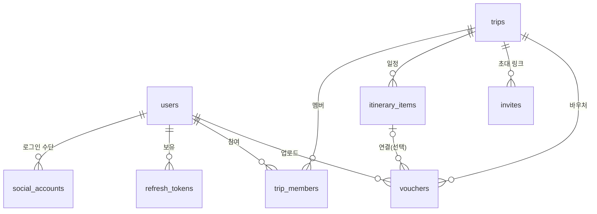

# 데이터 모델

> 상태: 초안 (2026-11-08) — 승인 대기
> 범위: MVP (M1 일정·동선, M4 협업·오프라인 바우처 지갑, 소셜 로그인)
> 관련 문서: [04-architecture.md](04-architecture.md), [../security/threat-model.md](../security/threat-model.md)

## 1. 원칙

- **Google 데이터는 약관이 허용하는 것만 저장한다** (아래 2절)
- **식별자는 UUID**, 서버가 생성. UUID는 추측을 어렵게 할 뿐 권한 확인을 대신하지 않는다
- **시간은 UTC로 저장.** 일정의 현지 날짜·시각은 여행의 시간대(IANA 이름)와 같이 해석한다
- **동시 수정은 `version` 컬럼**으로 감지한다 (낙관적 잠금)
- **토큰·초대 토큰은 해시만 저장**한다
- **민감도 표시**: 🔴 높음(유출 시 계정 탈취·신원 도용) / 🟡 중간(개인정보) / ⚪ 낮음

## 2. Google 데이터 저장 규칙

Google Maps Platform 약관 기준 (2026-11 확인):

| 데이터 | 저장 | 근거 |
|---|---|---|
| `place_id` | ✅ 기한 없이 저장 가능 | 캐시 제한 예외 |
| 위도·경도 | ⏱ 최대 30일, 이후 삭제 또는 갱신 | Service Specific Terms (Places, Routes) |
| 장소 이름·주소·사진·평점·리뷰 | ❌ 저장 금지 | 정책 페이지가 명시적으로 금지 |
| 이동시간·거리 (Routes) | ❌ 저장 허용 조항 없음 → 저장하지 않음 | Routes 정책: 대부분 캐시 제한 |

이에 따른 설계:
- 일정 항목에는 `place_id`, 좌표(+ 받은 시각), **사용자가 입력한 제목·메모**만 저장한다
- 장소 이름·주소·사진은 온라인일 때 `place_id`로 매번 받아서 보여준다 (필드 마스크로 필요한 항목만)
- 이동시간은 **저장하지 않고**, 하루 일정을 볼 때 서버가 계산해서 응답에만 담는다
- 좌표는 받은 지 30일이 지나면 서버가 갱신하거나 지운다 (주기 작업)
- 오프라인에서는 사용자가 쓴 제목, 메모, 계획 시각, 이동수단만 보인다

## 3. 관계도

## 4. 테이블

### users — 사용자

| 컬럼 | 타입 | 설명 | 민감도 |
|---|---|---|---|
| id | uuid PK | | |
| display_name | varchar(50) | 앱에 보이는 이름 | 🟡 |
| email | varchar(320) NULL | 공급자가 준 이메일. **표시·연락용, 로그인 식별에 쓰지 않음** (T02) | 🟡 |
| created_at, updated_at | timestamptz | | |

### social_accounts — 소셜 로그인 연결

| 컬럼 | 타입 | 설명 | 민감도 |
|---|---|---|---|
| id | uuid PK | | |
| user_id | uuid FK → users | | |
| provider | enum(`kakao`, `apple`, `google`) | | |
| subject | varchar(255) | 공급자의 사용자 ID (`sub`) | 🟡 |
| created_at | timestamptz | | |

- UNIQUE(provider, subject) — **사용자 식별은 이 조합으로만** (T02)

### refresh_tokens — 리프레시 토큰

| 컬럼 | 타입 | 설명 | 민감도 |
|---|---|---|---|
| id | uuid PK | | |
| user_id | uuid FK → users | | |
| family_id | uuid | 같은 로그인에서 이어진 토큰 묶음. 재사용 감지 시 묶음 전체 폐기 (T03) | |
| token_hash | char(64) UNIQUE | SHA-256 해시. 원문은 저장하지 않음 | 🔴 |
| expires_at | timestamptz | | |
| used_at | timestamptz NULL | 갱신에 쓰인 시각. 이미 쓴 토큰이 다시 오면 탈취로 판단 | |
| revoked_at | timestamptz NULL | 로그아웃·탈퇴·재사용 감지 | |
| created_at | timestamptz | | |

- 만료된 행은 주기 작업으로 삭제

### trips — 여행

| 컬럼 | 타입 | 설명 | 민감도 |
|---|---|---|---|
| id | uuid PK | | |
| title | varchar(100) | | 🟡 |
| destination | varchar(100) | 사용자가 입력한 목적지 텍스트 | 🟡 |
| start_date, end_date | date | 현지 날짜. CHECK(start_date ≤ end_date) | 🟡 집이 비는 기간 |
| timezone | varchar(64) | IANA 이름 (예: `Europe/Paris`) | |
| version | int | 여행 정보 수정 시 증가 | |
| created_at, updated_at | timestamptz | | |

- 여행 기간 상한 (예: 60일)은 API 검증에서

### trip_members — 여행 멤버

| 컬럼 | 타입 | 설명 |
|---|---|---|
| trip_id | uuid FK → trips | PK(trip_id, user_id) |
| user_id | uuid FK → users | |
| role | enum(`owner`, `editor`, `viewer`) | |
| joined_at | timestamptz | |

- 여행마다 `owner`는 정확히 1명 (부분 UNIQUE 인덱스: `WHERE role = 'owner'`)
- 멤버 수 상한 (예: 20명)은 API 검증에서

### itinerary_items — 일정 항목

| 컬럼 | 타입 | 설명 | 민감도 |
|---|---|---|---|
| id | uuid PK | | |
| trip_id | uuid FK → trips | | |
| day | date | 여행 기간 안의 현지 날짜 | 🟡 |
| position | int | 하루 안에서의 순서. UNIQUE(trip_id, day, position) | |
| title | varchar(100) | **사용자 콘텐츠.** 오프라인에서 보이는 이름 | 🟡 |
| memo | varchar(1000) NULL | 사용자 콘텐츠 | 🟡 |
| google_place_id | varchar(255) NULL | 장소 없이 메모만 있는 항목도 허용 | |
| lat, lng | numeric(9,6) NULL | Google에서 받은 좌표. **30일 제한** | 🟡 숙소 위치 |
| location_fetched_at | timestamptz NULL | 좌표를 받은 시각. 30일 지나면 갱신·삭제 | |
| start_time | time NULL | 계획한 현지 시각 | |
| stay_minutes | int NULL | 머무는 시간 | |
| travel_mode | enum(`drive`, `transit`, `walk`) NULL | 이전 항목에서 이 항목까지 이동수단. 사용자가 선택 | |
| version | int | 수정 시 증가 | |
| created_by, updated_by | uuid FK → users NULL | 탈퇴 시 NULL | |
| created_at, updated_at | timestamptz | | |

- 이동시간·거리 컬럼은 **없음** (2절)
- 순서 변경은 하루 단위 요청 하나로: 항목 ID와 version 목록을 받아 한 트랜잭션에서 position을 다시 매긴다

### invites — 초대 링크

| 컬럼 | 타입 | 설명 | 민감도 |
|---|---|---|---|
| id | uuid PK | | |
| trip_id | uuid FK → trips | | |
| token_hash | char(64) UNIQUE | 128비트 이상 랜덤 토큰의 SHA-256. 원문 미저장 (T10·T14) | 🔴 |
| role | enum(`editor`, `viewer`) | 참여하면 받는 권한. `owner`는 불가 | |
| max_uses | int | 기본값 예: 10 | |
| use_count | int | 참여할 때 원자적으로 증가: `UPDATE ... WHERE use_count < max_uses` (T12) | |
| expires_at | timestamptz | 기본값 예: 7일 | |
| revoked_at | timestamptz NULL | | |
| created_by | uuid FK → users NULL | | |
| created_at | timestamptz | | |

### vouchers — 바우처

| 컬럼 | 타입 | 설명 | 민감도 |
|---|---|---|---|
| id | uuid PK | | |
| trip_id | uuid FK → trips | | |
| uploader_id | uuid FK → users | | |
| visibility | enum(`private`, `trip`) | 기본 `private` = 올린 사람만 (T09) | |
| title | varchar(100) | 사용자 입력 (예: "파리행 항공권") | 🟡 |
| day | date NULL | 연결할 날짜 | |
| itinerary_item_id | uuid FK → itinerary_items NULL | 연결할 일정 항목. 항목 삭제 시 NULL | |
| content_type | enum(`application/pdf`, `image/jpeg`, `image/png`) | 서버가 파일 시그니처로 판별한 값 (T15) | |
| size_bytes | int | 상한 예: 10MB | |
| storage_key | varchar(255) UNIQUE | 서버가 만든 랜덤 이름. 원래 파일 이름 미사용 | |
| encryption_meta | jsonb | 암호화 방식·키 정보. **형식은 바우처 설계에서 확정** | 🔴 |
| sha256 | char(64) | 파일 무결성 확인 | |
| version | int | | |
| created_at, updated_at | timestamptz | | |

- 파일 내용(여권번호 등)이 🔴이므로 파일 자체는 스토리지에 암호화 저장 (T16·T17)
- 원래 파일 이름은 저장하지 않는다 (개인정보가 들어 있는 경우가 많음, 예: `홍길동_여권.pdf`)

## 5. 권한표

| 동작 | owner | editor | viewer | 비멤버 |
|---|:-:|:-:|:-:|:-:|
| 여행·일정 조회 | ✅ | ✅ | ✅ | ❌ |
| 여행 정보 수정 | ✅ | ✅ | ❌ | ❌ |
| 여행 삭제 | ✅ | ❌ | ❌ | ❌ |
| 일정 항목 추가·수정·삭제·순서 변경 | ✅ | ✅ | ❌ | ❌ |
| 장소 검색·이동시간 계산 | ✅ | ✅ | ✅ (조회 시 이동시간) | ❌ |
| 초대 링크 생성·폐기 | ✅ | ❌ | ❌ | ❌ |
| 멤버 권한 변경·내보내기 | ✅ | ❌ | ❌ | ❌ |
| 소유권 넘기기 | ✅ | ❌ | ❌ | ❌ |
| 여행에서 나가기 | ❌ (먼저 소유권 넘기기) | ✅ | ✅ | — |
| 바우처 올리기 (자기 것) | ✅ | ✅ | ✅ | ❌ |
| 바우처 보기 | 자기 것 + `trip` 공개 | 자기 것 + `trip` 공개 | 자기 것 + `trip` 공개 | ❌ |
| 바우처 수정·삭제·공개 범위 변경 | 자기 것만 | 자기 것만 | 자기 것만 | ❌ |

결정 포인트:
- **초대 링크는 owner만** 만든다. 편집자가 편집 권한 링크를 퍼뜨리는 경로를 막기 위해 (T11)
- **보기 전용 멤버도 자기 바우처는 올릴 수 있다.** 부모님처럼 일정은 안 고쳐도 자기 항공권은 갖고 다녀야 하는 경우
- **여행 owner도 남의 `private` 바우처는 못 본다.** 여권 정보 보호 (T09)
- 권한이 없을 때 비멤버에게는 `404`를 돌려준다 (여행이 존재하는지도 알려주지 않기 위해)

## 6. 삭제 규칙

| 상황 | 처리 |
|---|---|
| 회원 탈퇴 | 소셜 연결·리프레시 토큰·자기 바우처(파일 포함) 삭제 → 멤버십 삭제 → owner였던 여행은 가장 먼저 참여한 멤버에게 소유권 이전, 멤버가 없으면 여행 삭제 → `created_by`·`updated_by`는 NULL → users 행 삭제 |
| 여행 삭제 | 멤버·일정·초대·바우처(파일 포함) 모두 삭제 |
| 멤버 내보내기·나가기 | 멤버십 삭제. 그 사람이 올린 바우처는 **삭제** (남은 멤버가 볼 수 없게) |
| 일정 항목 삭제 | 연결된 바우처는 남기고 `itinerary_item_id`만 NULL |

- 스토리지 파일 삭제는 DB 트랜잭션이 끝난 뒤 실행하고, 실패하면 재시도 목록에 남긴다 (파일만 남는 상황 방지)
- 백업·로그에서의 파기 기간은 6단계(컴플라이언스)에서 정한다

## 7. 동기화

- MVP의 새로고침은 **여행 하나를 통째로 다시 받는다** (여행 정보 + 멤버 + 일정 + 바우처 목록). 여행 하나의 데이터가 작아서 변경분만 주고받는 구조는 필요 없다
- 그래서 삭제 기록(tombstone)도 두지 않는다. 받은 목록에 없으면 앱이 캐시에서 지운다
- 여행 목록 조회 결과에 없는 여행 = 내보내졌거나 삭제됨 → 앱이 그 여행의 캐시와 바우처 파일을 지운다 (T08)

## 8. MVP에서 DB에 두지 않는 것

| 항목 | 처리 |
|---|---|
| 요청 횟수 제한 카운터 | 서버 1대 기준 메모리 + Nginx. 서버를 여러 대로 늘리면 Redis 도입 검토 |
| 감사 로그 | 7단계에서 설계 |
| 로그인 nonce | 인증 설계(1단계)에서 저장 방식 결정 |

## 9. 열린 질문

- **일정 제목 자동 채우기**: 장소를 고르면 Google 장소 이름을 제목 칸에 미리 채워주고 사용자가 고칠 수 있게 할지. 편리하지만, Google 이름을 그대로 저장하는 셈이라 약관상 **회색지대**다. 출시 전에 Google Maps Platform 지원팀에 문의해 확인한다. 확인 전까지는 이름을 힌트로 보여주고, 저장은 사용자가 직접 입력한 값만 한다
- 기본값 수치 (여행 기간 60일, 멤버 20명, 초대 10회·7일, 바우처 10MB)는 API 설계 때 확정
