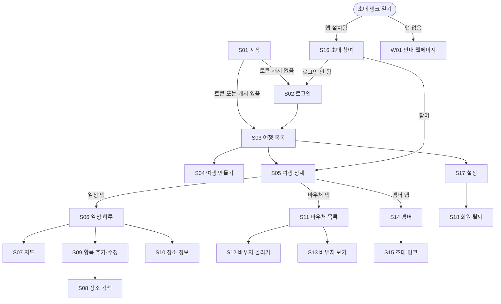

# 화면 설계

> 상태: 초안 (2026-11-08) — 승인 대기
> 범위: MVP (M1 일정·동선, M4 협업·오프라인 바우처 지갑, 소셜 로그인)
> 관련 문서: [04-architecture.md](04-architecture.md), [05-data-model.md](05-data-model.md), [06-api.md](06-api.md)
> 시각 디자인(색, 폰트, 아이콘)은 다루지 않는다. 화면 구성과 동작만 정한다

## 1. 원칙

- **오프라인에서도 앱이 열린다.** 캐시가 있으면 로그인 확인 없이 여행 목록·일정·바우처를 보여준다
- **수정은 온라인에서만.** 오프라인에서는 수정 버튼을 비활성화하고 이유를 보여준다
- **권한에 따라 버튼을 숨기되, 막는 건 서버가 한다.** 화면 숨김은 편의일 뿐 보안 장치가 아니다
- **부모님 세대도 쓸 수 있게.** 시스템 글자 크기 확대를 지원하고, 핵심 동작(바우처 열기)은 두 번 이내 터치로
- **언어**: MVP는 한국어만. 문자열은 처음부터 리소스 파일(ARB)로 분리
- **테마**: Material 3, 시스템 다크 모드 따라감

## 2. 화면 목록

| ID | 화면 | 경로 (go_router) | 오프라인 | 권한 차이 |
|---|---|---|---|---|
| S01 | 시작 | `/` | ✅ | — |
| S02 | 로그인 | `/login` | ❌ | — |
| S03 | 여행 목록 (홈) | `/trips` | ✅ 캐시 | — |
| S04 | 여행 만들기·수정 | `/trips/new`, `/trips/:id/edit` | ❌ | 수정은 O E |
| S05 | 여행 상세 (탭: 일정·바우처·멤버) | `/trips/:id` | ✅ 캐시 | — |
| S06 | 일정 (하루) | `/trips/:id/days/:date` | ✅ 일부 | 수정은 O E |
| S07 | 일정 지도 | `/trips/:id/days/:date/map` | ❌ | — |
| S08 | 장소 검색 | `/trips/:id/places/search` | ❌ | O E |
| S09 | 일정 항목 추가·수정 | `/trips/:id/items/new`, `/trips/:id/items/:itemId` | ❌ (보기는 ✅) | 수정은 O E |
| S10 | 장소 정보 (바텀 시트) | — | ❌ | — |
| S11 | 바우처 목록 | `/trips/:id/vouchers` | ✅ | — |
| S12 | 바우처 올리기·수정 | `/trips/:id/vouchers/new`, `/trips/:id/vouchers/:vid/edit` | ❌ | 수정은 본인 |
| S13 | 바우처 보기 | `/trips/:id/vouchers/:vid` | ✅ 받아둔 것 | — |
| S14 | 멤버 | `/trips/:id/members` | ✅ 보기만 | 관리는 O |
| S15 | 초대 링크 관리 | `/trips/:id/invites` | ❌ | O |
| S16 | 초대 참여 | `/invite` (딥링크) | ❌ | — |
| S17 | 설정 | `/settings` | ✅ 일부 | — |
| S18 | 회원 탈퇴 | `/settings/delete-account` | ❌ | — |
| W01 | 초대 안내 웹페이지 (앱 미설치) | `https://<도메인>/invite` | — | — |

## 3. 화면 흐름



## 4. 화면별 상세

### S01 시작
- 저장된 토큰이 있으면 S03으로. 토큰 갱신은 뒤에서 시도하고, 실패해도 캐시가 있으면 오프라인 모드로 S03을 보여준다
- 토큰도 캐시도 없으면 S02
- 딥링크로 열렸으면 처리 후 S16으로 (로그인 필요 시 로그인을 거쳐서)

### S02 로그인
- 카카오 · Apple · Google 버튼, 개인정보 처리방침·이용약관 링크
- 첫 가입이면 표시 이름 확인 칸 (공급자가 준 이름을 기본값으로, 비어 있으면 입력 요구)
- 실패 메시지는 일반적으로 ("로그인하지 못했습니다. 다시 시도해주세요") — 내부 에러 내용 미표시

### S03 여행 목록 (홈)
- 다가오는 여행 → 지난 여행 순. 카드: 제목, 목적지, 기간, 내 역할, 바우처 준비 상태(받아둔 수 / 전체)
- 여행 만들기 버튼 (오프라인이면 비활성)
- 당겨서 새로고침 → `GET /trips`. **목록에 없는 여행은 캐시와 바우처 파일 삭제** (T08)
- 오프라인 배너: "오프라인 — 마지막 동기화: 3시간 전"

### S04 여행 만들기·수정
- 입력: 제목, 목적지(자유 텍스트), 시작·종료일, 시간대
- 시간대: 검색 가능한 목록에서 선택. 기본값은 기기 시간대가 아니라 **빈 값** (해외여행이라 기기 시간대가 틀린 경우가 대부분)
- 수정 시 기간을 줄여 일정이 밀려나면 서버가 `409` → "이 날짜의 일정 N개를 먼저 옮기거나 삭제해주세요"

### S05 여행 상세
- 상단: 제목, 기간, 멤버 아바타, 내 역할 표시
- 탭 3개: **일정 / 바우처 / 멤버**
- 메뉴: 여행 수정(O E), 여행 삭제(O, 제목 다시 입력해서 확인), 여행 나가기(E V)

### S06 일정 (하루)

```
┌─────────────────────────────────┐
│ ← 파리 여행        12/24 (수) ▾ │  날짜 선택 (좌우 스와이프도 가능)
│ [목록] [지도]                    │
├─────────────────────────────────┤
│ 09:00  숙소                      │
│   │  🚇 대중교통 21분 · 3.9km     │  ← 이동 구간 (온라인일 때만)
│ 10:00  오르세 미술관   3시간      │
│        "목요일 야간 개장"         │
│   │  🚶 이동수단을 선택하세요     │  ← no_mode
│ 13:30  점심 (메모만)             │
│   │  — 장소 없음                 │  ← no_location
│                       [+ 추가]   │
└─────────────────────────────────┘
```

- 데이터: 스냅샷 캐시로 먼저 그리고, 온라인이면 `GET /days/{date}`로 이동 구간을 받아 채운다
- **오프라인**: 제목·계획 시각·머무는 시간·메모·이동수단만 보인다. 이동 구간 자리에 "오프라인 — 이동시간은 연결 후 표시"
- 계획 시각과 이동시간이 맞지 않으면(이전 일정 끝 + 이동시간 > 다음 시작) 해당 구간을 주황색으로 표시 (단순 경고, 2차의 동선 최적화와 별개)
- O E: 길게 눌러 순서 변경 → `PUT /order`, 밀어서 삭제(확인 대화상자)
- V: 보기만, 추가 버튼 없음

### S07 일정 지도
- 그날 장소들의 마커 + 순서 번호. 마커를 누르면 S10
- 경로선은 MVP에서 그리지 않고 마커만 (경로 데이터 저장 제한, 2차 검토)
- 온라인 전용. 오프라인이면 "지도는 연결 후 볼 수 있습니다"

### S08 장소 검색
- 검색어 입력 → 0.3초 멈추면 `GET /places/autocomplete` (입력마다 호출하지 않음 — 비용·호출 제한)
- 화면에 들어올 때 세션 토큰 생성, 장소를 고르면 그 세션 종료 (Google 과금 단위)
- 결과 목록 하단에 Google 출처 표시
- 장소 선택 → S09로 돌아가 `place_id` 채움

### S09 일정 항목 추가·수정
- 입력: **제목(필수)**, 장소(선택, S08), 날짜, 시작 시각, 머무는 시간, 이전 항목에서의 이동수단(차량·대중교통·도보), 메모
- 장소를 고르면 제목 칸 아래에 "Google 장소 이름: 오르세 미술관 [이 이름 사용]" 힌트. 저장되는 건 사용자가 입력하거나 확정한 제목 (약관 회색지대 대응, [05-data-model.md](05-data-model.md) 9절)
- 저장 시 `409 version_conflict` → 공통 충돌 처리 (5절)
- V는 같은 화면을 읽기 전용으로

### S10 장소 정보 (바텀 시트)
- `GET /places/{place_id}`: 이름, 주소, "Google 지도에서 열기" 버튼, Google 출처 표시
- 오프라인이면 "장소 정보는 연결 후 볼 수 있습니다" + 사용자가 쓴 제목·메모만

### S11 바우처 목록
- 날짜별로 묶어서 표시, 날짜 없는 바우처는 "기타"
- 항목: 제목, 올린 사람, 공개 범위 아이콘(🔒 나만 / 👥 여행 멤버), **받아둠 여부**
- 상단 버튼: **"오프라인용으로 모두 받기"** — 여행 시작 3일 전부터 홈·이 화면에서 안내 배너
- 올리기 버튼: 모든 멤버 (V 포함, 자기 바우처)

### S12 바우처 올리기·수정
- 파일 선택: 파일 앱(PDF·이미지) 또는 사진 보관함. 카메라 촬영은 2차
- 입력: 제목(필수), 날짜·일정 항목 연결(선택), **공개 범위 — 기본 "나만 보기"**
- "여행 멤버와 공유"를 고르면 경고: "여권번호 등 개인정보가 포함되어 있다면 공유하지 마세요" (T09)
- 업로드 전에 앱에서도 크기(10MB)·형식 확인 (편의용, 최종 검증은 서버)
- 업로드 성공하면 바로 기기에 암호화 저장 (받아둠 상태)

### S13 바우처 보기
- PDF(pdfrx) 또는 이미지 뷰어, 확대·축소
- **기기에 받아둔 파일이면 오프라인에서 바로 열림.** 안 받아뒀고 오프라인이면 "연결 후 받을 수 있습니다"
- 화면 밝기를 일시적으로 최대로 (바코드·QR 인식용, 옵션)
- **앱 전환 화면 가림**: 이 화면에서 앱이 백그라운드로 가면 앱 전환기 미리보기에 내용이 보이지 않게 가린다 (T31)
- 스크린샷은 막지 않는다 (사용자가 직접 보관하려는 정상 용도가 많음)

### S14 멤버
- 목록: 이름, 역할, 참여일
- O: 역할 변경, 내보내기(확인 대화상자: "이 멤버가 올린 바우처도 삭제됩니다"), 소유권 넘기기, 초대 링크 관리(S15)
- E V: 보기 + "여행 나가기"
- 내보내진 사람의 기기 캐시는 다음 동기화 때 지워진다는 점을 owner에게 안내 (수용한 위험, threat-model 5절)

### S15 초대 링크 관리 (O)
- 만들기: 역할(기본 **보기 전용**), 사용 횟수(기본 10), 유효 기간(기본 3일)
- 편집 권한을 고르면 경고: "링크를 받은 누구나 일정을 수정할 수 있습니다" (T11)
- 생성 직후 OS 공유 시트 열기. **토큰이 담긴 URL은 이때만 보여준다** — 다시 보기 불가, 필요하면 새로 만들기
- 목록: 역할, 사용 횟수, 남은 기간, 폐기 버튼

### S16 초대 참여
- 딥링크 `https://<도메인>/invite#<token>`으로 열림 → 로그인 확인 → `POST /invites/preview`
- 확인 화면: "홍길동 님이 '파리 여행'(12/22~12/29)에 보기 전용 멤버로 초대했습니다" [참여] [취소]
- 참여 → `POST /invites/accept` → S05
- 에러: 만료·폐기·소진(410) → "더 이상 쓸 수 없는 초대 링크입니다. 초대한 사람에게 새 링크를 요청하세요" / 이미 멤버 → 바로 S05
- 토큰은 화면·로그에 출력하지 않고, 처리 후 메모리에서 버린다

### S17 설정
- 표시 이름 변경, 로그아웃, 회원 탈퇴, 개인정보 처리방침, 오픈소스 라이선스, 앱 버전
- **로그아웃**: 서버 토큰 폐기 → 기기의 토큰·일정 캐시·바우처 파일·암호화 키 전부 삭제. 오프라인에서 로그아웃하면 기기 데이터는 즉시 지우고, 서버 폐기는 다음 연결 때 시도

### S18 회원 탈퇴
- 삭제되는 것 안내: 계정, 내가 올린 바우처, 내 멤버십. 내가 owner인 여행은 다른 멤버에게 넘어가거나 삭제됨
- 재인증: 가입한 소셜 로그인을 다시 진행 → `DELETE /me`
- 완료 후 기기 데이터 전부 삭제 → S02

### W01 초대 안내 웹페이지
- 앱이 설치되지 않은 사람이 링크를 열면 보이는 정적 페이지: 앱 소개, 앱스토어·플레이스토어 버튼
- **토큰을 읽거나 서버로 보내지 않는다** (fragment라 서버 로그에도 남지 않음). 앱 설치 후 링크를 다시 열어달라고 안내
- 같은 도메인에 Universal Links(`apple-app-site-association`)·App Links(`assetlinks.json`) 파일을 둔다

## 5. 공통 동작

| 상황 | 동작 |
|---|---|
| 로딩 | 캐시가 있으면 캐시를 먼저 보여주고 뒤에서 갱신. 없으면 스켈레톤 |
| 빈 상태 | 다음 행동 안내 ("첫 일정을 추가해보세요") |
| 오프라인 | 상단 배너 + 수정 버튼 비활성 ("연결 후 수정할 수 있습니다") |
| `401 token_expired` | 뒤에서 토큰 갱신 후 재시도. 갱신 실패 → 로그인 화면 (캐시는 유지, 같은 계정으로 다시 로그인하면 이어서 사용) |
| `403` | "권한이 없습니다" + 스냅샷 새로고침 (역할이 바뀌었을 수 있음) |
| `404` (여행) | "접근할 수 없는 여행입니다" → 그 여행의 캐시·바우처 삭제 → S03 |
| `409 version_conflict` | "다른 멤버가 먼저 수정했습니다" → 최신 내용을 보여주고 [내 수정 다시 적용] [취소]. 자동으로 덮어쓰지 않음 |
| `429` | "잠시 후 다시 시도해주세요" (`Retry-After` 동안 버튼 비활성) |
| `502 upstream_error` | 장소 검색·이동시간만 실패 표시, 나머지 화면은 정상 |
| 네트워크 오류 중 수정 | 저장되지 않았음을 분명히 표시. 몰래 재시도·대기열 없음 (오프라인 수정은 2차) |

## 6. 기기 데이터 정리 시점

| 시점 | 지우는 것 |
|---|---|
| 로그아웃, 탈퇴, 토큰 갱신 최종 실패 후 다른 계정 로그인 | 토큰, 모든 캐시, 모든 바우처 파일, 암호화 키 |
| 여행이 목록에서 사라짐 / 여행 404 | 그 여행의 캐시와 바우처 파일 |
| 바우처가 스냅샷에서 사라짐 (삭제·비공개 전환) | 그 바우처 파일 |
| 여행 종료 30일 후 | 그 여행의 바우처 파일 (여행 데이터는 유지, 다시 받을 수 있음) |

## 7. 열린 질문

- 바우처 카메라 촬영 (영수증 OCR과 같이 2차로 미뤘음 — MVP에 넣을지)
- 앱 잠금(생체 인증)을 MVP에 넣을지 — 분실 폰 위협(T18) 대응 강화, 2차로 계획
- 여행 종료 후 바우처 자동 삭제 기간 (30일 제안)
